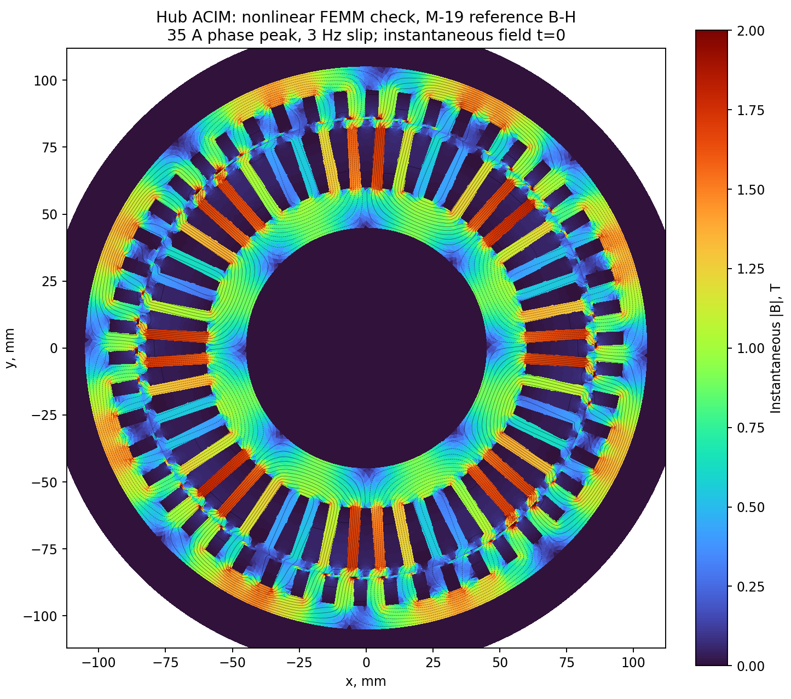
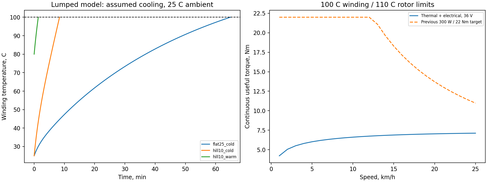

# Расчёт асинхронного мотор-колеса МИК: вариант 1

16 ноября 2026 года. **Предварительный электромагнитный и тепловой проект с выполненными расчётами FEMM. В изготовление не выпущен.**

**Уточнение от 17 ноября:** этот вариант не рассчитан под фактический донор Ninebot и домашнее изготовление только пластиковой печатью на Bambu Lab A1. [Новые ограничения изготовления](MOTOR_WHEEL_MANUFACTURING_CONSTRAINTS_RU.md) допускают заказ металлических узлов по чертежам; геометрию и режимы следующей версии требуется пересчитать.

**Уточнение по электронике от 17 ноября:** владелец подтвердил разработку с имеющимися **UNO Q + NUCLEO-G431RB + IHM09M2 + STEVAL-IPM15B**. Описанный ниже ODESC/F405 — прежний вариант, не текущий выбор. Предел 45 Apeak этой модели не относится к IPM15B. Питание, обмотку и токи следующей версии согласуем отдельно по [актуальным требованиям](MOTOR_WHEEL_MANUFACTURING_CONSTRAINTS_RU.md).

Расчёт выявил ограничение: габарит Ø220 мм с пакетом 40 мм не подтверждает прежние требования 300 Вт и 22 Н·м в длительном режиме при принятом охлаждении. На ровной дороге при 25 км/ч обмотка достигает 100 °C примерно через 65 минут с холодного состояния. На подъёме 5% при 10 км/ч — через 8.4 минуты, с принятого прогретого состояния — через 82 секунд. Эти времена являются результатом модели, а не разрешением на такой режим до измерений.

Рабочий вариант для исследовательского самоката: сниженная длительная нагрузка, датчики температуры и момента/скорости, ограничение тока и времени тяжёлого режима. Для длительных 300 Вт нужна следующая итерация геометрии или проверенная система отвода тепла. ИИ не устраняет медные потери при требуемом моменте.

## 1. Конкретный подбор: Ozon и AliExpress

| Узел | Выбор | Что подтверждено | Условие применения |
|---|---|---|---|
| Донор механики | [DDK, передний direct drive 1500 Вт, посадка 100 мм, без обода, Ozon 558756273](https://www.ozon.ru/product/motor-koleso-perednee-1500vt-pryamoy-privod-os-100-mm-ddk-bez-oboda-558756273/) | Карточка открывалась 16.11.2026; показаны около 18 464 ₽ с банковским предложением / 20 516 ₽ с другими банками | Это двигатель с постоянными магнитами. Используются пригодные корпус, фланцы, посадки и подшипники; статор и клетка будут новыми |
| Геометрия донора | [Ответы продавца Voltbikes](https://www.ozon.ru/product/motor-koleso-perednee-1500vt-pryamoy-privod-os-100-mm-ddk-bez-oboda-558756273/questions/) | Продавец указывает Ø22 см, 36 спиц, посадку вилки 100 мм, тормоз на 6 болтов | Внутренний диаметр и осевая полость не опубликованы; соответствие нового пакета не подтверждено |
| Инвертор-кандидат | [FLIPSKY ODESC 3.6, именно 56 V, с радиатором, AliExpress 1005002011798312](https://www.aliexpress.com/item/1005002011798312.html) | Модель найдена в поисковом индексе; [производитель](https://flipsky.net/collections/special-promotion-products/products/odesc3-6-dual-drive-controller-56v-with-heat-sink-optimizes-high-performance-brushless-motor-high-power-foc-bldc-based-on-odrive) указывает 8–56 V, 50 A continuous / 120 A peak, USB/UART/CAN, энкодер | AliExpress не отдал содержимое карточки: текущие вариант, цена и доставка не проверены. Это условный выбор, не закрытая закупочная спецификация |

Рекламные 50 A платы нельзя автоматически считать фазными RMS при любой температуре. В расчёте принят отдельный проектный предел **45 A пикового фазного вектора = 31,8 A RMS синусоиды**; его требуется подтвердить стендом и охлаждением платы. Первый пуск начинать с существенно меньшего тока. Использовать один канал ODESC; выходы каналов не соединять параллельно.

У найденного на Ozon [ODESC V4.2, артикул 4146697803](https://www.ozon.ru/product/servo-kontroller-stabilno-vysokaya-proizvoditelnost-shirokiy-diapazon-napryazheniy-dlya-4146697803/) указано 8–24 V: для батареи 10S он не подходит. Обычный контроллер электровелосипеда BLDC не принят как готовый контроллер асинхронного двигателя.

**Закупочный вывод:** DDK выбран условным механическим донором, ODESC — условным инвертором. До покупки донора требуется чертёж внутренних размеров или обмер доступного экземпляра. Готовых штатных статора и асинхронной клетки в этих карточках нет. Ссылки производителя и GitHub используются для проверки характеристик, покупка предполагается только на Ozon/AliExpress.

## 2. Основа Хабра и границы заимствования

Источник — [статья о мотор-колесе Оренбургского ГУ](https://habr.com/ru/companies/leader-id/articles/704916/). Использованы наружный короткозамкнутый ротор и пакет 40 мм из листов 0,5 мм. На [фрагменте размерного чертежа](https://habrastorage.org/r/w1560/getpro/habr/upload_files/361/8a6/cdf/3618a6cdf421652351a82359558b6a88.png) читаются осевые размеры 80 и 44 мм. Ø220 корпуса и Ø170 статора оценены по масштабу рисунка; это не нанесённые диаметры и не рабочие размеры исходного изделия. Неопределённость порядка ±10 мм принята как ориентир, без метрологического смысла.

Наш вариант трёхфазный. Числа пазов, полюсов, витков, сечения и параметры ниже — собственный выбор. Номиналы на иллюстрациях статьи не используются как результаты испытаний нашего двигателя.

| Размер | Проектное значение | Статус |
|---|---:|---|
| Корпус, наружный диаметр | 220 мм | Масштаб рисунка + совпадение с заявлением продавца донора |
| Целевая осевая ширина корпуса с крышками | 80 мм | Ориентир исходного чертежа; собственную компоновку ещё проверить |
| Активный пакет | 40 мм, 80 листов по 0,5 мм | Основа статьи |
| Статор: наружный диаметр / отверстие | 170 / 90 мм | Собственный проект |
| Пазы статора | 48; дно R60, плечо R82 мм; ширина 3,5→6,8 мм; устье 2,5 мм | Собственный проект, полный контур в FEMM |
| Ротор: внутренний / наружный диаметр железа | 170,8 / 210 мм | Собственный проект |
| Радиальный зазор | 0,40 мм | Нужны проверка биения и допусков; это не диаметральный зазор |
| Клетка | 50 медных стержней 4,8×10 мм | Расчётный выбор, нескошенные пазы |
| Два кольца клетки | Каждое 6×20 мм = 120 мм²; средний R95 мм | Собственный проект |

Для пакета с лобовыми частями зарезервирована внутренняя осевая полость примерно 72 мм. **Размер 44 мм из исходного чертежа такую компоновку не обеспечивает.** Поэтому нельзя обещать установку в старые крышки: требуются обмеры и, вероятно, новые крышки. Внутренняя расточка донора должна вместить Ø210 ротора с согласованной посадкой. Наружный Ø220 сам по себе этого не доказывает.

Пакет статора и ротора набирается из изолированных листов электротехнической стали. Сплошной стальной ротор и пакет из обычной конструкционной стали не являются эквивалентной заменой. Роторные ламели крепятся к корпусу расчётным способом; возможность использования старого магнитопровода донора как корпуса оценивается после разборки.

## 3. Обмотка

Три фазы, 8 полюсов (p=4), 48 пазов, q=48/(3·8)=2. Двухслойная обмотка, 48 катушек. Шаг 5 пазов вместо полного 6: катушка 1 возвращается в паз 6. В каждой фазе 16 катушек последовательно; одна параллельная ветвь; соединение «звезда», нейтраль изолирована.

**Каждая катушка: 6 витков жгутом из 8 параллельных эмалированных медных проводов Ø0,80 мм по голой меди.** Эти 8 проводов идут совместно по всей катушке и соединяются на концах, это не 8 независимых параллельных фазных ветвей.

| Величина | Расчёт |
|---|---:|
| Последовательные витки фазы | 96 |
| Обмоточный коэффициент основной гармоники | 0.93301 |
| Сечение жгута по меди | 4.021 мм² |
| Площадь тела паза, без горловины | 113.3 мм² |
| Медь двух сторон в пазу | 48.25 мм² |
| Общий коэффициент заполнения голой медью | 42.6% |
| Принятая средняя длина витка | 183.3 мм |
| Длина одного из 8 проводов на весь двигатель | 54.0 м |
| Суммарно провод Ø0,80, без запаса | 432 м; 1.95 кг |
| Сопротивление фазы при 20 / 100 °C | 0.07715 / 0.10141 Ом |
| Ожидаемое линейное сопротивление звезды при 20 °C | 0.15430 Ом |

Расчёт сопротивления: R=ρ·l/A, ρ20=0,01724 Ом·мм²/м; R(T)=R20[1+0,00393(T−20)]. Длина витка: 2L+2·2Rср·sin(πy/Z)+12 мм на изгибы. К фазе добавлено 0,4 м выводов. Длина лобовых частей и общий диаметр провода с эмалью подлежат проверке на одной пробной катушке.

Слои разделены на R71 мм; площадь нижнего слоя около 47,6 мм², его локальное заполнение голой медью около 50,7%. Оно выше среднего. Эмаль, пазовая изоляция и межслойная прокладка ещё уменьшают свободное сечение. Это **не подтверждённая наматываемость**: до заказа пакета нужен образец паза и пробная катушка. При необходимости разделитель слоёв переносится ближе к R72,7 с повторным расчётом. Для закупки ориентир — около 500 м провода, примерно 2,2 кг, с запасом; сечение фактической партии проверить.

Коэффициенты: kд=sin(qα/2)/(q·sin(α/2)), α=30°; kу=sin(5π/12); kw=kдkу=0,93301. Дискретная раскладка независимо проверена для всех трёх фаз. Полная таблица всех 48 катушек приведена в приложении и сохранена в JSON.

## 4. Клетка и потери ротора

При 20 °C сопротивление активного стержня: Rb=0,01724·0,040/48=14,37 мкОм. Сопротивление сегмента одного кольца между соседними стержнями: Re=ρ·(2π·0,095/50)/120=1,715 мкОм.

Для основной пространственной гармоники принята поправка двух колец:

Fend = 1 + Re/[2Rb·sin²(πp/Zr)] ≈ 1.965.

В 2D-модели σэфф=σCu/Fend; потери в таком стержне включают эквивалентные потери колец. Повторно прибавлять эти потери колец к рассчитанным FEMM потерям нельзя. Поправка приближённая: не воспроизводит пространственные гармоники и распределение тока в реальном соединении. Участки стержней за пакетом, контакты и влияние обоймы требуют 3D-модели или измерения; резервировать не менее 20% неопределённости приведённого Rr.

Для стержней требуется длина больше 40 мм: ориентировочно 52 мм с проходом через два кольца по 6 мм, плюс технологический припуск после выбора соединения. Оценка массы клетки в модели учитывает активные стержни и кольца, но не весь металл выступающих концов: к массе сборки добавить примерно 0,26 кг на эти концы. Соединения — конструктивно и электрически контролируемые; обычный непроконтролированный припой не даёт расчётного Rr. Требуются контроль сопротивлений, биения и балансировка.

На подъёме расчётный ток каждого стержня около 283 A RMS, сегмента кольца — около 568 A RMS. Плотности тока соответственно 5.9 и 4.7 A/мм². Из общих потерь клетки 69 Вт приходятся на активные стержни и 66 Вт на эквивалентные кольца. Дополнительный 1 мкОм в каждом из 100 контактов даёт ещё около 8 Вт. Для оценки используются сопротивления при 70 °C; контакты в исходном FEMM не добавлены. Заготовку медного прямоугольного проводника под окончательные 4,8×10 мм выбирать с припуском и контролировать фактическое сечение.

## 5. Реально выполненный FEMM

Использованы FEMM 4.2 x64 (22.10.2023) и pyFEMM 0.1.3. FEMM установлен отдельно в `%LOCALAPPDATA%/mic_motor_wheel_tools/femm42`, библиотека — в соседней `python`. Подлинность установщика сверена с SHA256 на сайте FEMM. Расчёт управляется через COM/Lua API, к стенду не обращается.

Модель: полный круг, 48 пазов статора и 50 ротора, воздушное окружение до R120 мм, A=0 на внешней границе, пакет 40 мм. Линейная сталь μr=2000 с коэффициентом пакета 0,95, без потерь в стали при идентификации. Открытые горловины пазов ротора исключают ложный эффект ненасыщаемого закрытого мостика. Токи фаз — сбалансированные **пиковые** комплексные амплитуды 1 A, 0/−120/+120°.

Выполнены 6 статических по положению ротора AC-задач на частотах 0,5; 1; 2; 4; 8; 16 Гц. Это частоты скольжения, а не моделирование вращающегося колеса. По [методу FEMM для асинхронных машин](https://www.femm.info/doku/doku.php?id=inductionmotorexample) восстановлена схема замещения:

L(ωsl)=Lσ + M/(1+jωslτr), Rr=M/τr.

| Параметр обратной Γ-схемы | Значение |
|---|---:|
| M | 6.9522 мГн |
| Lσ, только 2D | 0.6736 мГн |
| Добавка лобового рассеяния, допущение | 0.100 мГн |
| Rr, приведённое эффективное, 20 °C | 0.04988 Ом |
| τr при 20 °C | 0.1394 с |
| Bg основной гармоники / Idpeak | 0.04789 Тл/A |
| Принятый предел Bgpeak | 0,60 Тл |

Сетка: 60,484 узлов / 120,606 треугольников; проверочная — 84,190 / 168,018. Для 1 и 4 Гц изменение комплексной индуктивности при сгущении не более 0.10%. Расхождение момента по напряжениям Максвелла и по p·Pклетки/ωsl в основной серии не более 1.78%. Нормированная RMS-невязка аппроксимации комплексной индуктивности 0.017%.

Отдельно выполнена нелинейная проверка со справочной B–H-кривой **M-19 Steel из библиотеки FEMM**, а не с измеренной сталью будущего пакета: 35 Apeak, 3 Гц. Получены Bg основной гармоники 0.601 Тл, максимум выбранных отсчётов стали 1.825 Тл и момент 16.83 Н·м. Это одна проверочная точка насыщения; она не превращает линейную карту в идентифицированную нелинейную модель. Пиковые поля на острых кромках и гармонические потери не подтверждены.



Сохранены исходные `.fem`, решения `.ans`, JSON всех точек и воспроизводимые скрипты. Промежуточная тонкая клетка сохранена отдельно в `femm/baseline` для сравнения геометрии и не используется в итоговом расчёте. Нормировка Bg основной гармоники этого промежуточного журнала исправлена при постобработке с записью поправки в метаданных.

## 6. Рабочие точки и электрические ограничения

Транспортные допущения: масса 120 кг, диаметр качения 0,508 м, Crr=0,015, CdA=0,6 м², ρвозд=1,225 кг/м³, без ветра. Полная масса включает новый двигатель и человека. Уклон считается через atan(доля), а не как угол в градусах.

F=mg(Crr·cosθ+sinθ)+ρCdA·v²/2+ma; T=F·0,254; P=Tω; n=30ω/π.

Все точки ниже при Tw=80 °C, Tr=70 °C, Vdc=36 V. Предел модуля напряжения фазы: 0,9·Vdc/√3=18,71 Vpeak; предел тока 45 Apeak. Rs и Rr температурно скорректированы. Пиковые dq-токи не смешиваются с фазными RMS.

| Режим | Момент / механическая мощность | Фазный ток RMS | Потери меди / клетки | Общие потери / КПД двигателя |
|---|---:|---:|---:|---:|
| Ровно, 25 км/ч | 8.99 Н·м / 246 Вт | 15.7 A | 70 / 28 Вт | 114 Вт / 68.3% |
| Уклон 5%, 10 км/ч | 20.13 Н·м / 220 Вт | 29.7 A | 253 / 135 Вт | 402 Вт / 35.4% |

По ровному получены Id=12.53, Iq статора=18.27 Apeak, fст=19.32, fsl=1.91 Гц; Uф=13.50 Vpeak. Для подъёма Id=12.53, Iq=40.14 Apeak, fст=11.20, fsl=4.23 Гц; Uф=10.68 Vpeak. Оба режима электрически достижимы в модели, но подъём ограничен нагревом.

Уклон 5% при 25 км/ч и удержание 25 Н·м при остановке не проходят предел 45 Apeak. Прежнее задание «25 Н·м до 5 секунд» для этой обмотки не подтверждено. Краткий режим нельзя разрешать только по мощности батареи: фазный ток значительно больше тока DC.

Формулы обратной Γ-схемы: Te=1,5pM·Id·Iq; ωsl=(Rr/M)·Iq/Id; ψ=M·Id; ud=Rs·Id−ωeLσ·Iq,s; uq=Rs·Iq,s+ωe(Lσ+M)·Id. Ток эквивалентной ветви потерь добавляется к Iq,s, поэтому потребляемая фазная мощность совпадает с полезной мощностью и всеми учтёнными потерями. Это стационарная оценка, не готовая динамическая прошивка МИК.

Потери стали — допущение 3,5 Вт/кг при 1,5 Тл/50 Гц, 60% гистерезисной и 40% вихретоковой части, со степенями B^1,6 и B². Статор использует fст, ротор fsl. Это не паспорт выбранного материала; проверить диапазон хотя бы ×0,5…×2. Принята добавка PWM/прочих потерь 5 Вт + 1,5% мощности зазора. Трение: (0,15+0,001|ω|)·tanh(|ω|/0,5) Н·м. Указанные потери включены и в электрический баланс, и в нагрев.

## 7. Нагрев и длительный режим

Четыре узла: медь обмотки, железо статора, ротор с клеткой, корпус. Теплоёмкости соответственно 749, 1457, 2072, 1800 Дж/К. Масса активных материалов и условных корпуса/оси 11.97 кг, плюс около 0,26 кг выступающих стержней и неучтённые крепления/изоляция/датчики. Это не результат взвешивания донора.

Сеть: Rмедь–статор=0,18 K/Вт; Rстатор–корпус через неподвижные опоры=2 K/Вт; Rротор–корпус=0,04 K/Вт. Передача через зазор: G=λвозд·2πRL/g, λ=0,026 Вт/(м·К), g=0,0004 м. Дополнительный теплоотвод через лобовые полости отдельно не прибавлен; сеть требует идентификации. Излучение корпуса линеаризовано как h=4 Вт/(м²·К), конвекция h=5+6√v при v в м/с; внешняя площадь 0.130 м². Все эти коэффициенты — принятые оценки, не измеренные свойства донора.

C·dT/dt=Pпотерь(T)−K·(T−Tвозд). В расчёте меняются сопротивления и оптимальный Id по температуре. Пределы: 100 °C обмотка и 110 °C ротор. Для первой сборки реальные пороги отключения следует назначить ниже после проверки датчиков; холодный корпус не доказывает холодную обмотку.

| Воздух | Множитель внешней конвекции | Длительный момент, 10 км/ч | Длительный момент, 25 км/ч | Подъём 5% с холодного мотора, до лимита |
|---|---:|---:|---:|---:|
| 25 °C | 0.6 | 5.46 Н·м | 5.96 Н·м | 8.4 мин |
| 25 °C | 1.0 | 6.60 Н·м | 7.12 Н·м | 8.4 мин |
| 25 °C | 1.4 | 7.32 Н·м | 7.79 Н·м | 8.4 мин |
| 35 °C | 0.6 | 4.56 Н·м | 5.00 Н·м | 6.7 мин |
| 35 °C | 1.0 | 5.66 Н·м | 6.14 Н·м | 6.7 мин |
| 35 °C | 1.4 | 6.36 Н·м | 6.80 Н·м | 6.7 мин |

В номинальной модели длительная равномерная скорость по ровному около **18.7 км/ч**, при принятых 120 кг и 25 °C. Для 25 км/ч расчётная установившаяся температура обмотки 130 °C, выше лимита. Даже хороший инвертор этого ограничения не снимает. С ростом Crr, встречного ветра и потерь клетки допустимая скорость снизится.

Для отдельной точки 300 Вт при 25 км/ч и Tw/Tr=100/70 °C потери около 157 Вт. При этих потерях даже идеально охлаждённый до 25 °C корпус даёт в принятой внутренней сети около 105 °C обмотки. Следовательно, одного увеличения наружного радиатора недостаточно: нужно уменьшать потери либо менять путь тепла от статора/обмотки к корпусу. Это оценка при заданных потерях, без повторной идентификации охлаждаемой машины.

При увеличении приведённого Rr на 20% потери на подъёме растут примерно до 429 Вт, на 50% — до 470 Вт. Контакты клетки и выступающие части стержней существенны, хотя ток батареи может не выглядеть чрезмерным.

Начальное «прогретое состояние» для подъёма задано явно: обмотка/статор/ротор/корпус 80/75/70/50 °C. Это не названо установившимся режимом 25 км/ч. При воздухе 35 °C холодный запас времени меньше. После нескольких подъёмов таймер нельзя обнулять без учёта оставшегося тепла.



Снижение Id в данной точке 25 км/ч почти не даёт запаса: оптимум модели уже упирается в предел выбранной индукции. Для демонстрации МИК следует добавить точки малой нагрузки и одинаковую полезную работу, включая энергию проб и возврат к одному состоянию потока и скорости. Заранее назначенный процент экономии ИИ не заявляется.

## 8. Батарея и питание

Рабочий выбор по напряжению — готовая батарея **10S Li-ion, 36 V номинально / 42 V полностью заряженная**, около 14–20 А·ч; подтверждённая BMS на 30 A длительно и совместимый разъём. Конкретная карточка батареи в эту закупочную спецификацию не включена. Для модельного подъёма ток батареи около 18.6 A, по ровному 10.9 A при 36 V. Здесь КПД инвертора 95% и вспомогательная нагрузка 15 Вт — допущения. На 30 V ток батареи при том же режиме возрастёт, даже если фазный ток почти тот же.

По ровному модель потребляет 394 Вт от батареи. Батарея 36 V·14 А·ч при использовании 80% энергии даёт энергетическую оценку около 25.6 км при 25 км/ч, но этот непрерывный режим нарушает выбранный тепловой предел; такой пробег не является обещанием эксплуатации.

Батарею 13S «48 V» с максимумом 54,6 V для первого прототипа с платой 56 V не выбирать: мал запас по перенапряжению. На первых испытаниях рекуперацию отключить. После её включения нужны проверка способности BMS принимать заряд и тормозной резистор/чоппер по точной ревизии платы. Рабочие механические тормоза сохраняются независимо от питания. Предохранитель, DC-размыкатель, предварительный заряд и питание UNO Q через подходящий готовый DC/DC входят в электрическую компоновку; их номиналы окончательно назначаются по выбранной батарее и проводке.

## 9. Как это встраивается в МИК

Текущий стенд G431RB/IHM09M2/STEVAL-IPM15B с AIR56B2 остаётся отдельным стендом. Его параметры двигателя, 1,35 A и силовую часть 325 V в новое колесо не переносить. Этот расчёт не меняет стендовую прошивку и не запускает двигатель.

Практический маршрут с выбранной платой: **UNO Q / МИК → ограниченное задание Id и момента по UART/CAN → STM32F405 на ODESC → токовый FOC → новый ACIM**. Датчик скорости обязателен в первой версии. Механические импульсы энкодера пересчитываются с p=4 в электрическую скорость; PMSM-поиск неподвижного магнитного положения не считать калибровкой ACIM.

В [исходниках ODrive fw-v0.5.6](https://github.com/odriverobotics/ODrive/blob/fw-v0.5.6/Firmware/MotorControl/motor.cpp) присутствуют ACIM, калибровка R/L и регулирование намагничивания. Но штатная продаваемая прошивка клона и режим внешнего Id не подтверждены. Нужен отдельный порт ограниченного входа МИК и проверка ревизии платы. G431 нельзя подключить к стандартному ODESC как к готовому модулю с внешними 6 PWM: штатно им управляет собственный F405. Сохранение именно G431 в роли силового MCU потребует другого инвертора или аппаратной переделки; в этом варианте переносится алгоритм МИК на F405.

Для [оценивателя ODrive](https://github.com/odriverobotics/ODrive/blob/fw-v0.5.6/Firmware/MotorControl/acim_estimator.cpp) параметр `slip_velocity` играет роль 1/τr, а `rotor_flux_` нормирован в амперах, отслеживая Id. Это не поток в веберах. Для обратной Γ-модели стартовые оценки: `slip_velocity` ≈ 7.17 с⁻¹ при 20 °C и коэффициент произведения токов Te/(Id·Iq)=1,5pM≈0.04171 Н·м/A². Не записывать эти числа в прошивку как проверенный профиль: тип индуктивности, фильтры, масштаб токов, нагрев ротора и ветвь потерь требуют согласования и идентификации.

МИК/ИИ работает как надстройка: предлагает Id по LUT/модели с учётом нагрузки, скорости, температуры и ограничений. Быстрый токовый контур, перенапряжение, токовая отсечка, потеря энкодера, тайм-аут команды и температурное отключение исполняются локально и независимо от ИИ. При потере связи — детерминированное снижение момента. Выбором Id нельзя отменять пределы тока и температуры.

Параметры M и суммарное рассеяние из этой идентификации нельзя автоматически переименовать в независимые Lm, Lls и Llr существующей Т-схемы AIR56B2. Разложение рассеяния по двум сторонам не идентифицировано. Для полной энергетической модели нужен согласованный переход схем или дополнительные измерения.

## 10. Что проверено и что требуется до изготовления

Выполнены расчёт тяги, раскладка и сопротивление обмотки, поправка колец, 6 линейных FEA-точек, 2 сгущённые сетки, одна нелинейная точка, стационарные режимы, температурные переходы и чувствительность внешней конвекции. Восемь автоматических проверок контролируют симметрию обмотки и kw, физическую связь момента с потерями клетки, точность аппроксимации и сгущения сетки, баланс мощности, тепловой баланс и отбрасывание недостижимого момента.

Остаются обязательные входные данные: внутренние размеры и посадки донора; пробная укладка реального провода; свойства выбранной партии стали; сопротивление реальной клетки; калибровка токов/напряжения/энкодера; проверенные тепловые сопротивления. Это измерения будущего изделия, их нельзя получить из статьи или рекламной карточки.

Порядок реализации:

1. Обмерить донор, согласовать новые крышки и технологию оси. Если Ø210/72 мм не обеспечиваются, заменить донора или изменить геометрию с пересчётом.
2. Изготовить образец паза и катушки, измерить размеры, длину витка и сопротивление. Подтвердить изоляцию и монтаж датчика в меди.
3. Выбрать сталь и получить B–H/удельные потери. Повторить нелинейную карту и проверить комбинацию 48/50, пульсации, скос, шум и механическую прочность.
4. Решить тепловую цель: либо принять сниженный длительный режим, либо переработать габарит/отвод тепла и повторить расчёт. Для длительных 300 Вт текущую версию в производство не выпускать.
5. Собрать клетку с контролем контактов, проверить биение в рабочем зазоре и балансировку. Удержание момента осью и креплением к вилке рассчитать отдельно; два подходящих усилителя дропаутов не заменяют проверку вилки.
6. От лабораторного низковольтного источника проверить плату, датчики и ACIM FOC; затем идентифицировать новую машину. После этого подключать батарею и МИК в режиме наблюдения.
7. Провести одинаковые циклы FOC/МИК с измерением DC-энергии, момента, скорости и температур. Допуск к езде назначать по измеренным пределам.

Прочность корпуса, оси, крепления колеса, ударные дорожные нагрузки, ресурс подшипников, герметизация и 3D-лобовые эффекты этим 2D-проектом не закрыты. Представленные результаты достаточны для обоснования следующего прототипа и отказа от завышенных длительных номиналов, а не для заявления о готовом серийном двигателе.

## 11. Файлы и воспроизведение

Из `C:/mic_practice`:

```powershell
python research/motor_wheel/design_v1/femm_motor.py
python research/motor_wheel/design_v1/femm_motor.py --refine
python research/motor_wheel/design_v1/femm_motor.py --nonlinear
python research/motor_wheel/design_v1/calculate.py
python research/motor_wheel/design_v1/postprocess.py
python -m unittest discover -s research/motor_wheel/design_v1 -p test_design.py -v
python research/motor_wheel/design_v1/write_report.py
```

Нужны установленный FEMM с COM-регистрацией, pyFEMM, NumPy, SciPy и Matplotlib. Расчёты FEMM запускать последовательно: COM использует один экземпляр приложения. Остальные расчёты и тесты офлайн. Каталог `research/motor_wheel/design_v1/results` содержит JSON, таблицу обмотки и графики; `femm` — модели и решения. Предыдущий упрощённый расчёт в `research/motor_wheel/results` сохранён для истории и не заменяет эту итерацию.

## Приложение. Все катушки

Нумерация пазов по окружности с одной выбранной стороны. «+»/«−» задаёт направление тока верхней стороны относительно положительного тока фазы; возвратная сторона имеет противоположное направление. Все катушки одной фазы соединяются последовательно с соблюдением этих знаков. Перед силовым включением фазировку проверить малым током и измерением поля.

| Катушка | Фаза | Верхний паз | Знак | Нижний возвратный паз | Витков |
|---:|---|---:|---|---:|---:|
| 1 | A | 1 | + | 6 | 6 |
| 2 | C | 2 | − | 7 | 6 |
| 3 | C | 3 | − | 8 | 6 |
| 4 | B | 4 | + | 9 | 6 |
| 5 | B | 5 | + | 10 | 6 |
| 6 | A | 6 | − | 11 | 6 |
| 7 | A | 7 | − | 12 | 6 |
| 8 | C | 8 | + | 13 | 6 |
| 9 | C | 9 | + | 14 | 6 |
| 10 | B | 10 | − | 15 | 6 |
| 11 | B | 11 | − | 16 | 6 |
| 12 | A | 12 | + | 17 | 6 |
| 13 | A | 13 | + | 18 | 6 |
| 14 | C | 14 | − | 19 | 6 |
| 15 | C | 15 | − | 20 | 6 |
| 16 | B | 16 | + | 21 | 6 |
| 17 | B | 17 | + | 22 | 6 |
| 18 | A | 18 | − | 23 | 6 |
| 19 | A | 19 | − | 24 | 6 |
| 20 | C | 20 | + | 25 | 6 |
| 21 | C | 21 | + | 26 | 6 |
| 22 | B | 22 | − | 27 | 6 |
| 23 | B | 23 | − | 28 | 6 |
| 24 | A | 24 | + | 29 | 6 |
| 25 | A | 25 | + | 30 | 6 |
| 26 | C | 26 | − | 31 | 6 |
| 27 | C | 27 | − | 32 | 6 |
| 28 | B | 28 | + | 33 | 6 |
| 29 | B | 29 | + | 34 | 6 |
| 30 | A | 30 | − | 35 | 6 |
| 31 | A | 31 | − | 36 | 6 |
| 32 | C | 32 | + | 37 | 6 |
| 33 | C | 33 | + | 38 | 6 |
| 34 | B | 34 | − | 39 | 6 |
| 35 | B | 35 | − | 40 | 6 |
| 36 | A | 36 | + | 41 | 6 |
| 37 | A | 37 | + | 42 | 6 |
| 38 | C | 38 | − | 43 | 6 |
| 39 | C | 39 | − | 44 | 6 |
| 40 | B | 40 | + | 45 | 6 |
| 41 | B | 41 | + | 46 | 6 |
| 42 | A | 42 | − | 47 | 6 |
| 43 | A | 43 | − | 48 | 6 |
| 44 | C | 44 | + | 1 | 6 |
| 45 | C | 45 | + | 2 | 6 |
| 46 | B | 46 | − | 3 | 6 |
| 47 | B | 47 | − | 4 | 6 |
| 48 | A | 48 | + | 5 | 6 |
